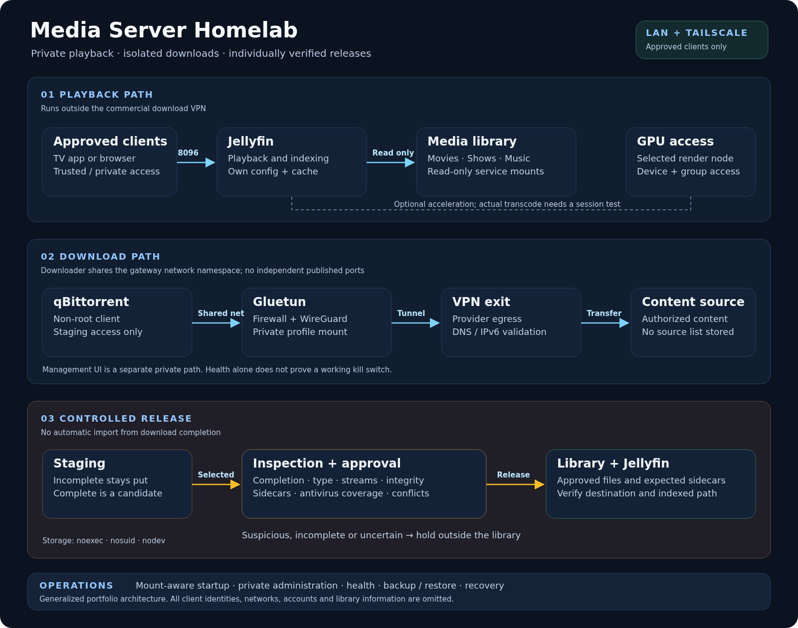

# Media Server Homelab

A Linux media server built around **Jellyfin, Tailscale, Docker, qBittorrent and
a WireGuard VPN gateway**, with separate download staging, read-only playback
libraries, GPU device access and a controlled media-intake process.

The engineering work is the integration: storage and permissions, service
lifecycle, two separate network paths, access controls, diagnostic helpers,
media verification and recovery procedures. Jellyfin, qBittorrent, Gluetun,
Tailscale and the other upstream tools remain their authors' software.

This is a **private, sanitized portfolio snapshot** of an existing homelab.
Examples use fictional paths, service identities and documentation networks.
No media, library screenshots, VPN profile, account data or live endpoint is
included. Publication did not change or restart the running installation.

## How it works



**Playback:** an approved device reaches Jellyfin through the trusted LAN or
private Tailscale path. Jellyfin reads the library, uses its own configuration
and cache, and can access a selected render device for hardware acceleration.

**Acquisition:** qBittorrent shares Gluetun's network namespace. Its intended
outbound path is the WireGuard tunnel; Jellyfin and host administration stay
outside that commercial VPN. Downloads remain in staging until individually
checked and approved for the library.

**Administration:** service startup, storage, private access and firewall
configuration are managed on the host. A read-only audit reports selected
containment checks without printing device addresses, environment variables,
library paths or account identifiers.

The diagram is a generalized architecture, not a screenshot or an exhaustive
security assessment. A [vector copy](docs/images/architecture.svg) is included. An editable [Mermaid version](docs/architecture.md) explains
the individual flows and trust boundaries.

## Components and work completed

| Area | Integration and operational work |
| --- | --- |
| Jellyfin | Container deployment; persistent configuration/cache; movies, shows and music libraries; post-install administration checks. |
| GPU | Corrected render-device mapping and supplemental group access; retained diagnostic and synthetic-playback procedures. |
| Storage | Separate staging/library trees on a mounted data disk; `noexec,nosuid,nodev`; read-only library mounts in Jellyfin. |
| Private access | Host Tailscale service and selected client access; LAN and private-network access treated as separate firewall cases. |
| Downloads | Small non-root qBittorrent image; shared Gluetun namespace; complete/incomplete folders; application binding and router-mapping controls. |
| VPN gateway | WireGuard profile mounted read-only; Gluetun firewall and DNS configuration; distinct management and transfer paths. |
| Service lifecycle | Mount-aware systemd startup, Compose configuration, health inspection and recovery helpers. |
| Intake | Completion/path review, torrent-piece integrity where available, magic/container checks, media probing, sidecar inspection and antivirus coverage review. |
| Release | Approved-item naming and conflict checks, controlled copy/move, library refresh and indexed-path verification. |
| Diagnostics | VPN/egress checks, controlled outage/recovery procedure, GPU checks and generated test-pattern media. |
| Portfolio tooling | Generalized reference configurations, a read-only audit helper, synthetic report, regression tests and architecture artwork. |

The original helpers were spread across deployment scripts and dated checks.
This snapshot consolidates their design into reviewable examples and runbooks;
it does not publish their private runtime records. See the
[evidence and limitations](docs/evidence.md) before treating any procedure as a
currently verified result.

## Explore without touching a server

Python 3 is sufficient for the offline audit demonstration and tests:

```sh
python3 scripts/audit_host.py
python3 -m unittest discover -s tests -q
```

The default report uses [fictional input](demo/inventory.json): **16 static
controls pass and six manual checks remain unverified**. It makes no network
requests and does not inspect the host. The checked-in
[demo report](demo/audit-report.json) can be compared with a fresh run.

Validate the reference Compose files without starting containers:

```sh
docker compose --env-file examples/.env.example -f examples/compose.jellyfin.yaml config --quiet
docker compose --env-file examples/.env.example -f examples/compose.jellyfin.yaml -f examples/compose.jellyfin-gpu.yaml config --quiet
docker compose --env-file examples/.env.example -f examples/compose.downloads.yaml config --quiet
```

The examples default to loopback management/playback ports, contain no VPN key,
and refuse to auto-create missing bind sources. They require host-specific
review before deployment. They are not an installer and are not automatically
applied to the existing homelab.

## Documentation map

| Document | What it covers |
| --- | --- |
| [Architecture](docs/architecture.md) | Playback, private access, VPN isolation, intake and integration boundaries. |
| [Deployment](docs/deployment.md) | Reference configuration, service identities, VPN settings, GPU override and startup order. |
| [Storage](docs/storage.md) | Persistent mounts, permissions, folder layout, naming, conflict checks and copy/hardlink trade-offs. |
| [Media intake](docs/media-intake.md) | The release gate from a completed download to a verified indexed library item. |
| [Security](docs/security.md) | Threats, firewall paths, DNS/IPv6, scanner limits, secrets and incident handling. |
| [Operations](docs/operations.md) | Health, private inspection, playback testing, backup/restore, outages, updates and troubleshooting. |
| [Evidence](docs/evidence.md) | Direct observations, historical artifacts, publication checks and unresolved limits. |
| [References](docs/references.md) | Upstream documentation and ownership. |

`examples/` holds generalized Compose, Dockerfile, systemd, preferences and
firewall references. `scripts/audit_host.py` is read-only; it has no media-import,
firewall-change, VPN-stop or deployment command. Ordinary tests use fabricated
fixtures and never contact the installed services.

## Scope

This demonstrates Linux administration, Docker networking, service integration,
storage containment, hardware troubleshooting and evidence-based operations.
It does not claim a newly written streaming server, an enterprise deployment,
continuous monitoring, guaranteed anonymity, or guaranteed malware-free media.

The source installation remains independent. No automatic commits, updates or
synchronization with this portfolio repository are configured. No open-source
license has been selected for the original documentation/helpers in this private
snapshot; upstream software keeps its own licensing.
