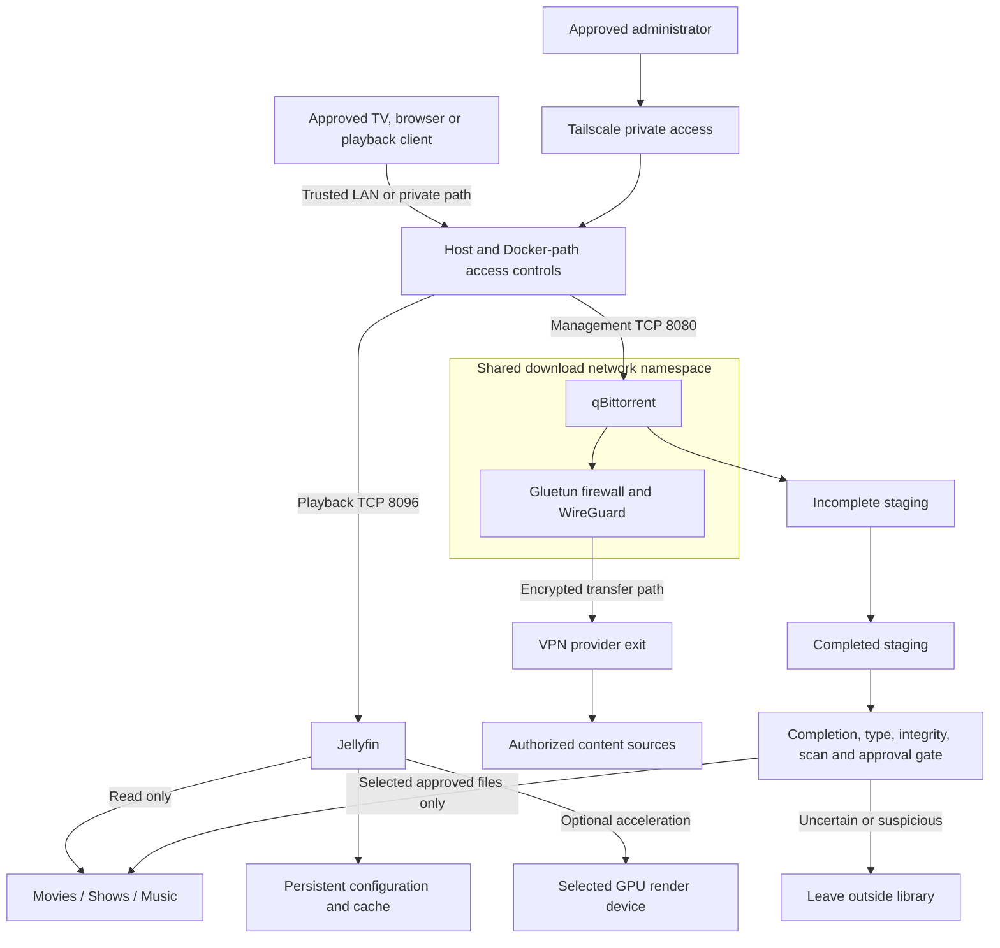

# Architecture and data flows

The deployed homelab has a streaming service on the host's ordinary network and
a download client in a separate VPN gateway namespace. Paths, clients and
networks below are generalized. The examples use safer loopback publishing;
the observed installation used host networking for Jellyfin and selected private
bindings for the download management UI.

## Boundary 1: viewing versus downloading

Jellyfin receives selected library bind mounts with `read_only: true`. It does
not receive incomplete or completed download staging. qBittorrent receives its
own configuration and staging directories, without a writable library bind.
An approved host-side release bridges those storage areas.

This limits what the two containers can change. It does not make a hostile
media file harmless to a parser, or prevent a host administrator from altering
the library. Existing hardlinks can create additional aliases to the same bytes;
[storage](storage.md) explains why that matters.

## Boundary 2: private access versus commercial VPN

Tailscale provides the host/client access path. Gluetun provides the commercial
VPN path for the downloader. These are separate jobs and separate trust models.
Changing the download tunnel should not be required to reach Jellyfin or to
administer the host.

qBittorrent uses `network_mode: service:vpn`. Its management port is published
by the gateway, not by an independent downloader bridge. The application should
also bind transfer traffic to the observed tunnel interface; namespace sharing,
application binding and firewall behavior need separate checks.

Gluetun health and a shared namespace establish configuration facts. They do
not prove DNS behavior, peer-observed addresses or a working kill switch during
failure. A controlled outage procedure covers those questions separately.

## Boundary 3: configuration versus display and evidence

Configuration state contains secrets, device targets and account information.
It stays outside source control. Diagnostic output is reduced to fixed booleans
and status labels before it becomes a report; raw `docker inspect`, service
logs, torrent names and public-address responses are not published.

The companion TV Live Dashboard can display selected service health through its
own filtered feed. That integration is outside the playback data path; a
dashboard outage does not need to stop streaming. No real feed or pairing data
is included here.

## Optional and excluded components

RustDesk appeared in the original planning material. Current installation and
unattended-access validation were not established in this publication, so it is
not represented as an operating component. Public hosting, router forwarding,
Tailscale Funnel, automated media acquisition and automatic release of completed
downloads are also outside this reference design.
