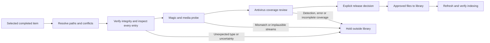

# Completed-media intake and release gate

This runbook consolidates the existing homelab's media safety workflow. It does
not download, move, extract or publish anything. Apply it only to content the
operator is authorized to obtain and store.

## 1. Establish scope and completion

Identify one exact completed-download path and its intended library path.
Confirm completion in the client or independently from verified metadata;
being under a folder named `complete` is not sufficient evidence. Do not release
an item from temporary/incomplete staging without independently proving completion.

Record a private inventory of the selected item only. Resolve paths and reject
unexpected symlinks, special files, traversal, destination conflicts or unrelated
contents. Preserve all other torrents and files. Hash/check the selected bytes
before and after operations where that establishes useful integrity evidence.

If torrent metadata is available, piece verification checks agreement with that
metadata. It does not prove the publisher is trustworthy or that the payload is
safe. Distinguish a complete recheck from a sample and account for every selected
file; do not publish torrent names, trackers or hashes as portfolio evidence.

## 2. Inspect contents and types

Inspect every directory entry, including hidden sidecars. Check file type from
magic/container inspection such as `file`, rather than trusting `.mkv`, `.mp4`
or another extension. Use `ffprobe` or an equivalent read-only probe to confirm
plausible audio/video streams, durations and metadata.

Executables, installers, scripts, shortcuts, disk images, device files,
unexpected archives, encrypted archives and extension/type mismatches stop the
release. Examples include `.exe`, `.msi`, `.scr`, `.com`, `.bat`, `.cmd`, `.ps1`,
`.js`, `.jar`, `.lnk`, `.desktop`, `.apk`, `.deb`, `.rpm`, `.AppImage` and `.iso`.
Do not execute, mount, extract or move them into the media library.

Keep only verified media and expected sidecars such as ordinary subtitles,
chapters, posters and metadata. A familiar title, release name or playable
opening frame is not a safety result. Use updated tools for inspection, with
read-only access and the least necessary privileges.

## 3. Prove scanner coverage

When an antivirus scanner is available, scan the selected completed item before
release. Record the engine/database freshness and inspect exit status, warnings,
limits, unreadable files and skipped content. A daemon being installed or a
client returning a short summary is not proof that every file was scanned.

Large media can exceed scanner limits. The historical tooling included whole
file and bounded/offset passes; those need an explicit coverage map and overlap
analysis. Multiple chunk scans do not necessarily equal an engine's whole-file
analysis, and a sample must not be described as complete coverage.

If coverage is incomplete, report the exact limitation and hold the release
until it is resolved or the owner makes an informed decision. A clean result is
supporting evidence, never a guarantee that a file is malware-free.

## 4. Release selected files

Confirm `noexec,nosuid,nodev` on the storage mount and read-only library binds in
Jellyfin. Check naming, capacity and destination conflicts. Show the exact plan
privately and apply only the authorized copy/move operation. Historical
hardlink imports have the aliasing limitation described in [storage](storage.md).

Do not weaken mount controls to accommodate a download, run a bundled player or
codec installer, or automatically trust other items in the same torrent.

## 5. Verify the library result

Verify the destination bytes and expected sidecars, then request a Jellyfin
library refresh if needed. Confirm the exact indexed path, intended library,
episode/movie identity and plausible media streams. Check playback where
appropriate using the non-admin playback account.

A successful filesystem copy does not prove indexing, and indexing does not
prove malware safety. Keep those results distinct in the receipt.

## Private receipt fields

| Field | Record privately |
| --- | --- |
| Scope | Exact selected source/destination, authorization and conflict decision. |
| Completion | Client completion or independent verification method. |
| Integrity | Verification method, coverage and destination match. |
| Type | Magic/container result, streams, duration and sidecar decisions. |
| Antivirus | Engine/database, full coverage or stated limits, status and findings. |
| Containment | Mount options and read-only container bind checks. |
| Release | Files changed and deliberately excluded; mechanism and rollback. |
| Jellyfin | Refresh result, indexed destination and playback/stream checks. |

Use fixed booleans and fictional examples in a public portfolio. Keep actual
paths, titles, media hashes, request identifiers, logs and library exports private.
